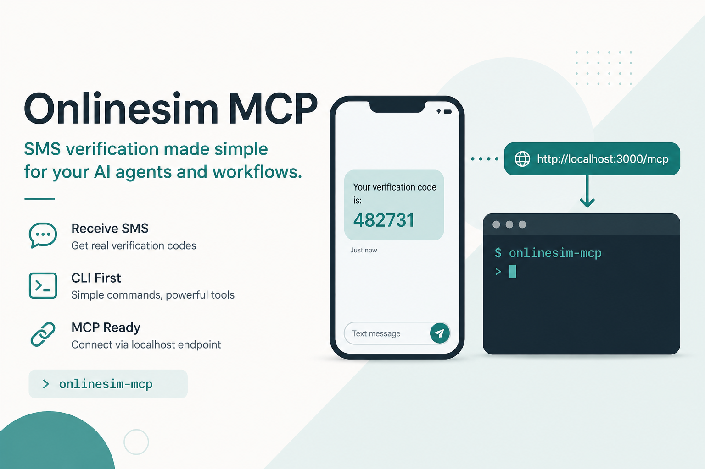

[](https://github.com/on-org/onlinesim-mcp/releases/latest)
[](https://github.com/on-org/onlinesim-mcp/releases)
[](https://www.rust-lang.org/)
[](https://modelcontextprotocol.io)
[](https://github.com/on-org/onlinesim-mcp/issues)
[](https://github.com/on-org/onlinesim-mcp/stargazers)
[](LICENSE)



# Onlinesim MCP

Local [MCP](https://modelcontextprotocol.io) server (Streamable HTTP) and CLI for [Onlinesim](https://onlinesim.io): order receive-only numbers and read SMS.

**Documentation: https://on-org.github.io/onlinesim-mcp/**

The API key lives in local config (`onlinesim login`) or `ONLINESIM_APIKEY`. Never pass the key in tool arguments.

## Install

```bash
# macOS / Linux
curl -fsSL https://raw.githubusercontent.com/on-org/onlinesim-mcp/master/install.sh | sh

# Windows PowerShell
irm https://raw.githubusercontent.com/on-org/onlinesim-mcp/master/install.ps1 | iex

# or let your agent install it (agent skill)
npx skills add on-org/onlinesim-mcp
```

Binaries: [GitHub Releases](https://github.com/on-org/onlinesim-mcp/releases). Details: [Install](https://on-org.github.io/onlinesim-mcp/install).

## Quick start

```bash
onlinesim login          # paste the API key
onlinesim mcp            # http://127.0.0.1:8787/mcp — keep it running
onlinesim mcp install    # wire Cursor for this project (other clients: see the docs)
```

Then ask the agent: *"Get me a number for Telegram and wait for the code."*

## Documentation

- [Install](https://on-org.github.io/onlinesim-mcp/install) — per OS, agent skill, updates
- [Connect a client](https://on-org.github.io/onlinesim-mcp/clients) — Cursor, Claude Code, VS Code, Codex, Claude Desktop
- [MCP tools](https://on-org.github.io/onlinesim-mcp/tools) — all 15 tools with inputs, answers and errors
- [CLI](https://on-org.github.io/onlinesim-mcp/cli) — terminal commands, JSON output
- [Configuration](https://on-org.github.io/onlinesim-mcp/configuration) — key, env, logs, autostart, tray, network safety
- [Changelog](https://on-org.github.io/onlinesim-mcp/changelog)

## License

Apache License 2.0
